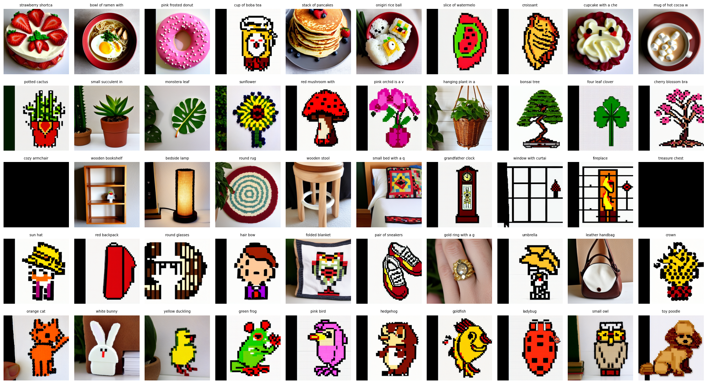

# Paint by Pixel 🍓🧩

ECE 649 Generative AI · Fall 2026 · Jesica Garcia

**Fine-tuning Stable Diffusion 1.5 with LoRA for cozy pixel-art sprites, then turning each sprite into a color-by-number puzzle.**

## Problem
General text-to-image models can be asked for "pixel art" but what they produce rarely resembles actual pixel art.

First, I generated a baseline of 200 images with plain Stable Diffusion 1.5 with 50 test prompts × 4 seeds, asking every time for a "pixel art sprite, single object, centered, plain white background."

What came back (seed 0):
- **Photos instead of pixel art:** 16 of 50 prompts came out as photographs, especially food (7/10).
- **Not clean pixel art:** even pixel-style outputs have uneven pixel sizes, soft edges, and too many shades.
- **Artifacts:** a black bar along the left edge in roughly 25 of 50 images.
- **Off-prompt subjects:** for instance "hair bow" became a face and busy backgrounds instead of plain white.
- **Safety-filter false positives:** 12 of 200 images were blank, for example "cozy armchair".

None of these can be dropped into a game or turned into a coloring page as-is,
which is what this project sets out to fix.

## Approach
1. Text → image: Stable Diffusion 1.5 (+ LoRA, coming soon)

## Setup

## Data

## Evaluation
- Test set: 50 held-out prompts (`eval/prompts.csv`), 10 per category, seeds 0–3.
- Baseline: plain SD 1.5, same prompts/seeds/settings. Generation run details are in `results/baseline/manifest.csv`.

## Results

## Limitations

## Acknowledgments

## Current status
**Building dataset** Baseline complete - 200 images. Next: collecting and captioning the dataset (CCO sprites)
